<!-- loio5ca3b42b86964c1999a13a80649e7093 -->

# CIS Agent Development — Industry AI Concept

This repository contains a concept created by the CIS (Customer Industry Solutions) Technology and Operations team for building, monitoring, and governing AI agents within SAP's Industry AI and FDE (Forward Deployed Engineering) context. The deliverable is a **reference architecture and design pattern collection** grounded in SAP's AI-Native North Star Architecture, the BAIP managed agent runtime, and FDE delivery constraints.

<a name="loio5ca3b42b86964c1999a13a80649e7093__section_overview"/>

## Overview

The deliverable is a **reference architecture and design pattern collection** — not production code — usable for:

-   **FDE engagements**: as a design reference during Discovery and Execute phases
-   **Customer conversations**: as a framework for discussing agent governance with enterprise architects and process owners
-   **Internal enablement**: as a shared language for CIS practitioners designing Industry AI solutions

The concept is grounded in SAP's AI-Native North Star Architecture, the BAIP (Business AI Platform) managed agent runtime, [Joule Studio](https://help.sap.com/docs/joule-studio "Joule Studio documentation hub covering agent development, intent-based development, and enterprise deployment.") :arrow_upper_right: as the mandatory development foundation, and FDE delivery constraints (90-day sprints, 300 Person Days, productization → standard SAP product).

<a name="loio5ca3b42b86964c1999a13a80649e7093__section_two_documents"/>

## Two Complementary Documents

This project contains two documents serving different audiences. They share the same design patterns; they are optimized for different readers and contexts.

**Table: Concept vs. Playbook Comparison**

<table>
<tr>
<th valign="top"></th>
<th valign="top">
Concept (`concept/`)</th>
<th valign="top">Playbook SAP/CIS Edition (`documents/`)</th>
</tr>
<tr>
<td valign="top">**Primary audience**</td>
<td valign="top">CIS architects, CIS leadership, enterprise architects</td>
<td valign="top">FDE delivery squad at sprint kickoff</td>
</tr>
<tr>
<td valign="top">**What it answers**</td>
<td valign="top">Why this design? What are the trade-offs?</td>
<td valign="top">What do I do this week? What must be true before handover?</td>
</tr>
<tr>
<td valign="top">**Structure**</td>
<td valign="top">12 chapters by topic</td>
<td valign="top">3 delivery tracks (Build / Operate / Enable) + checklists</td>
</tr>
<tr>
<td valign="top">**Prerequisite knowledge**</td>
<td valign="top">SAP platform familiarity</td>
<td valign="top">Practitioner ready to run an engagement</td>
</tr>
<tr>
<td valign="top">**Source of truth for**</td>
<td valign="top">Architectural decisions, security posture, governance patterns</td>
<td valign="top">Operational checklists, engagement timeline, exit criteria</td>
</tr>
</table>

The concept is the design rationale; the playbook operationalizes it.

<a name="loio5ca3b42b86964c1999a13a80649e7093__section_concept_document"/>

## Concept Document

The concept is structured as twelve topics plus an introduction. Start with [Introduction: Why Agent Governance Matters for Industry AI](introduction-c495d02.md) for an oriented overview, or jump directly to the topic most relevant to your role.

**Table: Concept Topic Guide**

<table>
<tr>
<th valign="top">Topic</th>
<th valign="top">Title</th>
<th valign="top">What It Covers</th>
</tr>
<tr>
<td valign="top">[Introduction](introduction-c495d02.md)</td>
<td valign="top">Introduction</td>
<td valign="top">Project context, 13 design questions, topic guide, role-based starting points, platform constraints</td>
</tr>
<tr>
<td valign="top">[Agent Quality Framework](agent-quality-framework-5ec914b.md)</td>
<td valign="top">Agent Quality Framework</td>
<td valign="top">Three-dimensional quality measurement (technical, process KPI, business outcomes); TDD/BDD and test onion approach; ten evaluation dimensions; runtime escalation path</td>
</tr>
<tr>
<td valign="top">[Supervisor Agent Pattern](supervisor-agent-pattern-3b166f3.md)</td>
<td valign="top">Supervisor Agent Pattern</td>
<td valign="top">Supervisor vs. worker design; nine alternatives evaluated; three supervisor workflows (inline quality relay, telemetry monitor, support relay); data protection design</td>
</tr>
<tr>
<td valign="top">[Security and Data Protection](security-and-data-protection-27868d4.md)</td>
<td valign="top">Security and Data Protection</td>
<td valign="top">Agent-specific threats; three-tier AI defense model; agent identity and least-privilege; security as testable requirements; data flows and legal alignment</td>
</tr>
<tr>
<td valign="top">[Precision Guardrails](precision-guardrails-c279f4e.md)</td>
<td valign="top">Precision Guardrails</td>
<td valign="top">Four-layer guardrail stack for numerical outputs; domain examples; human approval thresholds; audit trail requirements</td>
</tr>
<tr>
<td valign="top">[Joule Studio Build Map](joule-studio-build-map-7de243e.md)</td>
<td valign="top">Joule Studio Build Map</td>
<td valign="top">Concrete implementation using Joule Studio n8n nodes; master build map table; TR1–TR14 mandatory production readiness checklist (incl. TR13 Agent Action Metering); FDE build sequence</td>
</tr>
<tr>
<td valign="top">[CIS CoE Operations Model](cis-coe-operations-model-57b29ae.md)</td>
<td valign="top">CIS CoE Operations Model</td>
<td valign="top">Post-productization lifecycle management; supervisor as CIS proxy; Adoption Strategy lifecycle; Enable track with 4-stage gradual release; 6-scenario runbook library; continuous improvement loop</td>
</tr>
<tr>
<td valign="top">[Multi-Agent Orchestration](multi-agent-orchestration-2f6e92e.md)</td>
<td valign="top">Multi-Agent Orchestration</td>
<td valign="top">When and how to compose specialist agents; three topologies (flat, per-worker supervised, shared supervisor); supervisor patterns at scale</td>
</tr>
<tr>
<td valign="top">[Production Operations](production-operations-f963579.md)</td>
<td valign="top">Production Operations</td>
<td valign="top">Agent versioning (five-component version stack); rollback mechanics; AI Units billing; cost/token monitoring; dev → test → prod migration; productization triggered at RTC EAC; TR1–TR14 shipping checklist</td>
</tr>
<tr>
<td valign="top">[Reusable Components](reusable-components-8a3dd4c.md)</td>
<td valign="top">Reusable Components and Reference Implementations</td>
<td valign="top">Three-layer reusability stack (deploy as-is / parameterize / engagement-specific); CIS Starter Kit definition; RAG ingest pattern; context transfer schema; cross-engagement improvement loop</td>
</tr>
<tr>
<td valign="top">[Token Efficiency](token-efficiency-54fe998.md)</td>
<td valign="top">Token Efficiency in Industry AI Delivery</td>
<td valign="top">Two cost pools (build-time vs. runtime); SAP L0–L6 optimization framework; FDE engineer guidelines (APM, caching, tool gating, session handoff); runtime efficiency; quality–efficiency connection</td>
</tr>
<tr>
<td valign="top">[Agent Evaluation](agent-evaluation-65fd098.md)</td>
<td valign="top">Agent Evaluation in FDE Sprints</td>
<td valign="top">Testing vs. evaluation; four-phase evaluation lifecycle; aeval framework (offline + online, TR9 mandatory); spec quality evaluation (agentic-eval, 11+1 criteria); test case DSL; Quality Flywheel mapped to sprint weeks; success rate as primary release gate</td>
</tr>
<tr>
<td valign="top">[Customer Enablement and Adoption](customer-enablement-and-adoption-ce2e74a.md)</td>
<td valign="top">Customer Enablement and Adoption</td>
<td valign="top">Enable track as mandatory parallel workstream; Adoption Strategy lifecycle (7 sections, 9 governance roles); 4-stage gradual release; 7-audience role-based training matrix; enablement readiness checklist; CoE support tiers</td>
</tr>
</table>

Open design questions and platform verification items are tracked in [Open Questions](open-questions-ab50037.md). A structured concept critique covering all 12 topics — active findings ranked P1–P4, resolution status (addressed, external work required, accepted as-is) — is maintained separately. A change-log of all updates made in response to the FDE Agent Engagement Playbook analysis is also tracked separately.

<a name="loio5ca3b42b86964c1999a13a80649e7093__section_fde_playbook"/>

## FDE Agent Engagement Playbook — SAP CIS Edition

The playbook is a practitioner-facing operational guide for FDE delivery squads. It is structured around three delivery tracks that run in parallel throughout the engagement:

-   **Build track** — agent architecture, observability, evaluation harness, versioning, guardrails, dependencies
-   **Operate track** — observability setup, evaluation harness in CI, versioning and deployment, controls, runbook library
-   **Enable track** — customer capability assessment, role-based training, 4-stage gradual release, learning-by-doing exercises

The SAP CIS Edition integrates BAIP-specific implementation details (OTel harness built into the BAIP managed runtime, generative AI hub model pinning, `joule deploy` for CMJ/BYOA delivery, Adoption Strategy as the FDE handover artifact) as flowing text within the standard playbook structure — no separate callout blocks. It is designed to be read by the FDE squad at engagement kickoff and used actively throughout the sprint.

Quick-reference assets:

-   [**Cheat Sheet: CMJ vs. BYOA**](cheat-sheet-cmj-byoa-fde-371eef1.md) — two-dimension model for FDE BYOA agent delivery
-   [**FDE Overview**](fde-overview-8496556.md) — FDE within SAP Industry AI; process, squad roles, CIS fit, FDE vs. CAIA

<a name="loio5ca3b42b86964c1999a13a80649e7093__section_thirteen_design_questions"/>

## Thirteen Core Design Questions

1.  How do we ensure an agent works correctly — at build time and at runtime?
2.  How do we handle failures autonomously: self-correct vs. escalate?
3.  Does a supervisor agent pattern make sense within SAP's architecture?
4.  How do we protect customer data while still enabling operational monitoring?
5.  How do we address security at development time AND at runtime?
6.  How do we enforce precision guardrails for business-critical numerical outputs?
7.  How do we manage agent lifecycle after productization: monitor, maintain, and continuously improve?
8.  When does an Industry AI use case require multiple specialist agents, and how do we orchestrate and govern them safely?
9.  How do we version, roll back, and migrate agents across environments without service disruption?
10.  Which design components can be reused across engagements, and what constitutes a CIS starter kit for efficient delivery at scale?
11.  How do we manage token efficiency across FDE build-time and Industry AI runtime to maintain a sustainable cost per correct outcome?
12.  How do we evaluate agent quality systematically across an FDE sprint — from first prototype through to production monitoring?
13.  How do we ensure customer organizations are actually able to adopt and sustain the agent after the FDE team departs?

<a name="loio5ca3b42b86964c1999a13a80649e7093__section_sap_strategic_alignment"/>

## SAP Strategic Alignment

This work sits at the intersection of three SAP strategic pillars:

-   **Autonomous Enterprise** — SAP's vision: AI agents execute E2E business processes across apps, data, and organizations. The Autonomous Suite ships with 224 specialized agents and 51 Joule Assistants across five domains (Finance, Spend, SCM, HCM, CX). Industry AI adds vertical depth for the most complex, sector-specific challenges.
-   **AI-Native North Star Architecture** — four layers: User Experience (Joule Work), Process (apps as capability providers), Foundation (Knowledge Graph + BDC + model services), Platform (BAIP managed agent runtime)
-   **BAIP (Business AI Platform)** — three sub-layers: Context (Knowledge Graph, 7M+ fields), Build ([Joule Studio](https://help.sap.com/docs/joule-studio "Joule Studio documentation hub covering agent development, intent-based development, and enterprise deployment.") :arrow_upper_right:), Governance (SAP AI Agent Hub)

<a name="loio5ca3b42b86964c1999a13a80649e7093__section_key_constraints"/>

## Key Constraints

-   All development uses **Joule Studio** as the primary and mandatory foundation
-   Every agent runs on the **BAIP managed agent runtime** — security, observability, tenant isolation, and OpenTelemetry telemetry are provided by the harness, not built custom
-   **Human-in-the-loop** is the default — agents automate repeatable tasks; humans intervene at judgment points via `sapTaskCenter`
-   **FDE delivery constraint**: ~90 calendar days, 300 Person Days hard cap; the concept is designed to be deliverable within these bounds
-   All files in `context/` are marked **INTERNAL — SAP and external parties under NDA only**

<a name="loio5ca3b42b86964c1999a13a80649e7093__section_repository_structure"/>

## Repository Structure

```mermaid
graph TD
    root["agent_development/"]
    root --> readme["README.md — This file"]
    root --> claude["CLAUDE.md — AI assistant context"]
    root --> concept["concept/"]
    root --> documents["documents/"]
    root --> context_dir["context/"]

    concept --> ch00["chapter-00-introduction.md"]
    concept --> ch01["chapter-01-agent-quality-framework.md"]
    concept --> ch02["chapter-02-supervisor-agent-pattern.md"]
    concept --> ch03["chapter-03-security-data-protection.md"]
    concept --> ch04["chapter-04-precision-guardrails.md"]
    concept --> ch05["chapter-05-joule-studio-build-map.md"]
    concept --> ch06["chapter-06-cis-coe-operations-model.md"]
    concept --> ch07["chapter-07-multi-agent-orchestration.md"]
    concept --> ch08["chapter-08-production-operations.md"]
    concept --> ch09["chapter-09-reusable-components.md"]
    concept --> ch10["chapter-10-token-efficiency.md"]
    concept --> ch11["chapter-11-agent-evaluation.md"]
    concept --> ch12["chapter-12-customer-enablement-adoption.md"]
    concept --> oq["open-questions.md"]
    concept --> poc["proof-of-concept-plan.md"]
    concept --> ctx["context-layer-overview.md"]

    documents --> playbook["FDE Agent Engagement Playbook — SAP CIS Edition.md"]
    documents --> assets["assets/"]
    assets --> cheat["cheat-sheet-cmj-byoa-fde.md"]
    assets --> fdeov["FDE_Overview.md"]

    context_dir --> iai["industry_ai/ — INTERNAL"]
    context_dir --> nsa["north_star_architecture/ — INTERNAL"]
    context_dir --> strat["strategy/ — INTERNAL"]
    context_dir --> fde["fde/ — INTERNAL"]
```

**Related Information**  

[What Is Joule Studio](https://help.sap.com/docs/joule-studio/joule-studio/what-is-joule-studio "What is Joule Studio: intent-based development approach, enterprise context grounding, and development paths.") :arrow_upper_right:

[SAP AI Launchpad Overview](https://help.sap.com/docs/ai-launchpad/sap-ai-launchpad/sap-ai-launchpad-overview "SAP AI Launchpad: centralized AI lifecycle management for scenarios, deployments, and evaluations across runtimes.") :arrow_upper_right:

[Introduction: Why Agent Governance Matters for Industry AI](introduction-c495d02.md)

[Agent Quality Framework](agent-quality-framework-5ec914b.md)

[Open Questions](open-questions-ab50037.md)
