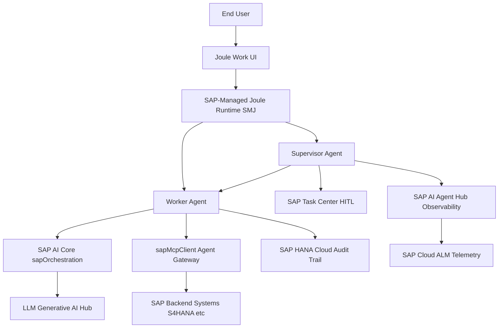

<!-- loio8e9e563d0eba4abf82d247a95b6422b3 -->

# CIS Agent Development — Industry AI Concept

This document set provides the reference architecture and design pattern collection for building, monitoring, and governing AI agents within SAP's Industry AI and Forward Deployed Engineering (FDE) context. It covers all aspects of the agent lifecycle, from quality frameworks and security design to production operations and customer enablement.

<a name="loio8e9e563d0eba4abf82d247a95b6422b3__section_overview"/>

## Overview

This documentation is created by the CIS (Customer Industry Solutions) Technology and Operations team. The content is a **reference architecture and design pattern collection** — not production code — usable for:

-   **FDE engagements**: as a design reference during Discovery and Execute phases
-   **Customer conversations**: as a framework for discussing agent governance with enterprise architects and process owners
-   **Internal enablement**: as a shared language for CIS practitioners designing Industry AI solutions

The concept is grounded in SAP's AI-Native North Star Architecture, the BAIP (Business AI Platform) managed agent runtime, Joule Studio as the mandatory development foundation, and FDE delivery constraints (90-day sprints, 300 Person Days, productization to standard SAP product).

<a name="loio8e9e563d0eba4abf82d247a95b6422b3__section_architecture"/>

## Architecture Overview

The following diagram shows the principal components of the CIS Industry AI agent architecture and their relationships.

<a name="loio8e9e563d0eba4abf82d247a95b6422b3__section_two_documents"/>

## Two Complementary Documents

This documentation set contains two documents serving different audiences. They share the same design patterns and are optimized for different readers and contexts.

**Audience and Purpose Comparison**

<table>
<tr>
<th valign="top">

Attribute

</th>
<th valign="top">

Concept (`concept/`)

</th>
<th valign="top">

Playbook SAP/CIS Edition (`documents/`)

</th>
</tr>
<tr>
<td valign="top">

**Primary audience**

</td>
<td valign="top">

CIS architects, CIS leadership, enterprise architects

</td>
<td valign="top">

FDE delivery squad at sprint kickoff

</td>
</tr>
<tr>
<td valign="top">

**What it answers**

</td>
<td valign="top">

Why this design? What are the trade-offs?

</td>
<td valign="top">

What do I do this week? What must be true before handover?

</td>
</tr>
<tr>
<td valign="top">

**Structure**

</td>
<td valign="top">

12 chapters by topic

</td>
<td valign="top">

3 delivery tracks (Build / Operate / Enable) + checklists

</td>
</tr>
<tr>
<td valign="top">

**Prerequisite knowledge**

</td>
<td valign="top">

SAP platform familiarity

</td>
<td valign="top">

Practitioner ready to run an engagement

</td>
</tr>
<tr>
<td valign="top">

**Source of truth for**

</td>
<td valign="top">

Architectural decisions, security posture, governance patterns

</td>
<td valign="top">

Operational checklists, engagement timeline, exit criteria

</td>
</tr>
</table>

The concept is the design rationale; the playbook operationalizes it.

<a name="loio8e9e563d0eba4abf82d247a95b6422b3__section_chapters"/>

## Concept Chapters

The concept is structured as twelve chapters plus an introduction.

**Concept Document Structure**

<table>
<tr>
<th valign="top">

Topic

</th>
<th valign="top">

Title

</th>
<th valign="top">

What It Covers

</th>
</tr>
<tr>
<td valign="top">

[Introduction to AI Agent Governance](introduction-d5b45b3.md)

</td>
<td valign="top">

Introduction

</td>
<td valign="top">

Project context, 13 design questions, chapter guide, role-based starting points, platform constraints

</td>
</tr>
<tr>
<td valign="top">

[Agent Quality Framework](agent-quality-framework-b8b5eb8.md)

</td>
<td valign="top">

Agent Quality Framework

</td>
<td valign="top">

Three-dimensional quality measurement (technical, process KPI, business outcomes); TDD/BDD and test onion approach; ten evaluation dimensions; runtime escalation path

</td>
</tr>
<tr>
<td valign="top">

[Supervisor Agent Pattern](supervisor-agent-pattern-9d3924d.md)

</td>
<td valign="top">

Supervisor Agent Pattern

</td>
<td valign="top">

Supervisor vs. worker design; nine alternatives evaluated; three supervisor workflows (inline quality relay, telemetry monitor, support relay); data protection design

</td>
</tr>
<tr>
<td valign="top">

[Security and Data Protection](security-and-data-protection-0fadcd8.md)

</td>
<td valign="top">

Security and Data Protection

</td>
<td valign="top">

Agent-specific threats; three-tier AI defense model; agent identity and least-privilege; security as testable requirements; data flows and legal alignment

</td>
</tr>
<tr>
<td valign="top">

[Precision Guardrails](precision-guardrails-ed7c517.md)

</td>
<td valign="top">

Precision Guardrails

</td>
<td valign="top">

Four-layer guardrail stack for numerical outputs; domain examples; human approval thresholds; audit trail requirements

</td>
</tr>
<tr>
<td valign="top">

[Joule Studio Build Map](joule-studio-build-map-29946d5.md)

</td>
<td valign="top">

Joule Studio Build Map

</td>
<td valign="top">

Concrete implementation using Joule Studio n8n nodes; master build map table; TR1–TR14 mandatory production readiness checklist; FDE build sequence

</td>
</tr>
<tr>
<td valign="top">

[CIS CoE Operations Model](cis-coe-operations-model-5b71a67.md)

</td>
<td valign="top">

CIS CoE Operations Model

</td>
<td valign="top">

Post-productization lifecycle management; supervisor as CIS proxy; Adoption Strategy lifecycle; Enable track with 4-stage gradual release; 6-scenario runbook library; continuous improvement loop

</td>
</tr>
<tr>
<td valign="top">

[Multi-Agent Orchestration](multi-agent-orchestration-2a50a7c.md)

</td>
<td valign="top">

Multi-Agent Orchestration

</td>
<td valign="top">

When and how to compose specialist agents; three topologies (flat, per-worker supervised, shared supervisor); supervisor patterns at scale

</td>
</tr>
<tr>
<td valign="top">

[Production Operations](production-operations-6a2ed30.md)

</td>
<td valign="top">

Production Operations

</td>
<td valign="top">

Agent versioning; rollback mechanics; AI Units billing; cost/token monitoring; dev → test → prod migration; TR1–TR14 shipping checklist

</td>
</tr>
<tr>
<td valign="top">

[CIS Delivery Efficiency and Reusable Components](reusable-components-b03a699.md)

</td>
<td valign="top">

Reusable Components and Reference Implementations

</td>
<td valign="top">

Three-layer reusability stack; CIS Starter Kit definition; RAG ingest pattern; context transfer schema; cross-engagement improvement loop

</td>
</tr>
<tr>
<td valign="top">

[Token Efficiency](token-efficiency-a49034e.md)

</td>
<td valign="top">

Token Efficiency in Industry AI Delivery

</td>
<td valign="top">

Two cost pools (build-time vs. runtime); SAP L0–L6 optimization framework; FDE engineer guidelines; runtime efficiency; quality–efficiency connection

</td>
</tr>
<tr>
<td valign="top">

[Agent Evaluation in FDE Sprints](agent-evaluation-80dcfa4.md)

</td>
<td valign="top">

Agent Evaluation in FDE Sprints

</td>
<td valign="top">

Testing vs. evaluation; four-phase evaluation lifecycle; aeval framework (offline + online); spec quality evaluation; test case DSL; Quality Flywheel mapped to sprint weeks

</td>
</tr>
<tr>
<td valign="top">

[Customer Enablement and Adoption](customer-enablement-adoption-0f138c6.md)

</td>
<td valign="top">

Customer Enablement and Adoption

</td>
<td valign="top">

Enable track as mandatory parallel workstream; Adoption Strategy lifecycle (7 sections, 9 governance roles); 4-stage gradual release; role-based training matrix

</td>
</tr>
</table>

<a name="loio8e9e563d0eba4abf82d247a95b6422b3__section_design_questions"/>

## Thirteen Core Design Questions

This documentation addresses thirteen fundamental design questions for Industry AI agent development:

1.  How do we ensure an agent works correctly — at build time and at runtime?
2.  How do we handle failures autonomously: self-correct vs. escalate?
3.  Does a supervisor agent pattern make sense within SAP's architecture?
4.  How do we protect customer data while still enabling operational monitoring?
5.  How do we address security at development time AND at runtime?
6.  How do we enforce precision guardrails for business-critical numerical outputs?
7.  How do we manage agent lifecycle after productization: monitor, maintain, and continuously improve?
8.  When does an Industry AI use case require multiple specialist agents, and how do we orchestrate and govern them safely?
9.  How do we version, roll back, and migrate agents across environments without service disruption?
10.  Which design components can be reused across engagements, and what constitutes a CIS starter kit for efficient delivery at scale?
11.  How do we manage token efficiency across FDE build-time and Industry AI runtime to maintain a sustainable cost per correct outcome?
12.  How do we evaluate agent quality systematically across an FDE sprint — from first prototype through to production monitoring?
13.  How do we ensure customer organizations are actually able to adopt and sustain the agent after the FDE team departs?

<a name="loio8e9e563d0eba4abf82d247a95b6422b3__section_sap_alignment"/>

## SAP Strategic Alignment

This work sits at the intersection of three SAP strategic pillars:

-   **Autonomous Enterprise** — SAP's vision: AI agents execute end-to-end business processes across apps, data, and organizations. The Autonomous Suite ships with 224 specialized agents and 51 Joule Assistants across five domains (Finance, Spend, SCM, HCM, CX). Industry AI adds vertical depth for the most complex, sector-specific challenges.
-   **AI-Native North Star Architecture** — four layers: User Experience (Joule Work), Process (apps as capability providers), Foundation (Knowledge Graph + BDC + model services), Platform (BAIP managed agent runtime)
-   **BAIP (Business AI Platform)** — three sub-layers: Context (Knowledge Graph, 7M+ fields), Build (Joule Studio), Governance (SAP AI Agent Hub)

<a name="loio8e9e563d0eba4abf82d247a95b6422b3__section_constraints"/>

## Key Constraints

-   All development uses **Joule Studio** as the primary and mandatory foundation
-   Every agent runs on the **BAIP managed agent runtime** — security, observability, tenant isolation, and OpenTelemetry telemetry are provided by the harness, not built custom
-   **Human-in-the-loop** is the default — agents automate repeatable tasks; humans intervene at judgment points via `sapTaskCenter`
-   **FDE delivery constraint**: approximately 90 calendar days, 300 Person Days hard cap; the concept is designed to be deliverable within these bounds

> ### Note:  
> All documentation in this set covers internal SAP delivery patterns. Content is intended for SAP CIS teams and external parties operating under NDA only.

**Related Information**  

[SAP AI Agent Hub](https://help.sap.com/docs/AI_AGENT_HUB/225000cc2ce44a228b9534a0f1098a9b/8ebd704d35a746c180af003db1f5acb0.html "SAP AI Agent Hub is a single entry point for the discovery and governance of AI agents, LLMs, and MCP servers across your enterprise.") :arrow_upper_right:

[Joule Studio](https://help.sap.com/docs/JOULESTUDIO/7e496fe6f81f4975aec07d9c1cbd2aef/36d3e974446844a1b0ffb7af8fa9446c.html "Joule Studio is SAP's AI-first environment to create enterprise solutions from intent to deployment.") :arrow_upper_right:

[Introduction to AI Agent Governance](introduction-d5b45b3.md)

[FDE Agent Engagement Playbook](fde-agent-engagement-playbook-8e52459.md)
