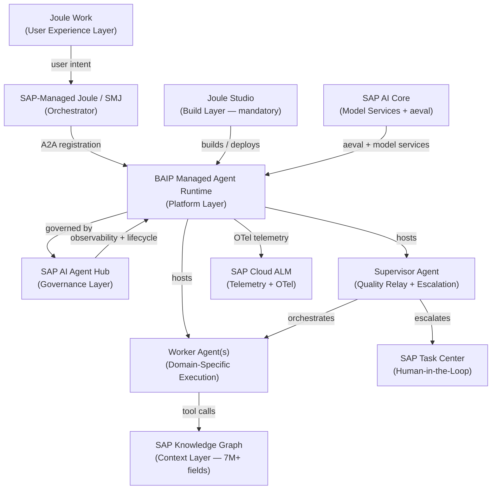

<!-- loio8e9e563d0eba4abf82d247a95b6422b3 -->

# CIS Agent Development: Industry AI Overview

This document provides the reference architecture and design pattern collection for building, monitoring, and governing AI agents within SAP's Industry AI and Forward Deployed Engineering (FDE) context. It is produced by the CIS (Customer Industry Solutions) Technology and Operations team and is grounded in SAP's AI-Native North Star Architecture, the BAIP managed agent runtime, Joule Studio as the mandatory development foundation, and FDE delivery constraints.

<a name="loio8e9e563d0eba4abf82d247a95b6422b3__section_purpose"/>

## Purpose and Audiences

This reference architecture is designed for use in three contexts:

-   **FDE engagements**: as a design reference during Discovery and Execute phases
-   **Customer conversations**: as a framework for discussing agent governance with enterprise architects and process owners
-   **Internal enablement**: as a shared language for CIS practitioners designing Industry AI solutions

The concept answers thirteen core design questions that arise in every high-stakes agent deployment. It is not production code.

<a name="loio8e9e563d0eba4abf82d247a95b6422b3__section_two_documents"/>

## Two Complementary Documents

This project contains two documents serving different audiences. They share the same design patterns and are optimized for different readers and contexts.

**Table: Document Comparison**

<table>
<tr>
<th valign="top">

Attribute

</th>
<th valign="top">

Concept

</th>
<th valign="top">

FDE Agent Engagement Playbook — SAP CIS Edition

</th>
</tr>
<tr>
<td valign="top">

**Primary audience**

</td>
<td valign="top">

CIS architects, CIS leadership, enterprise architects

</td>
<td valign="top">

FDE delivery squad at sprint kickoff

</td>
</tr>
<tr>
<td valign="top">

**What it answers**

</td>
<td valign="top">

Why this design? What are the trade-offs?

</td>
<td valign="top">

What do I do this week? What must be true before handover?

</td>
</tr>
<tr>
<td valign="top">

**Structure**

</td>
<td valign="top">

12 chapters by topic

</td>
<td valign="top">

3 delivery tracks (Build / Operate / Enable) + checklists

</td>
</tr>
<tr>
<td valign="top">

**Prerequisite knowledge**

</td>
<td valign="top">

SAP platform familiarity

</td>
<td valign="top">

Practitioner ready to run an engagement

</td>
</tr>
<tr>
<td valign="top">

**Source of truth for**

</td>
<td valign="top">

Architectural decisions, security posture, governance patterns

</td>
<td valign="top">

Operational checklists, engagement timeline, exit criteria

</td>
</tr>
</table>

The concept is the design rationale; the playbook operationalizes it.

<a name="loio8e9e563d0eba4abf82d247a95b6422b3__section_architecture_overview"/>

## Architecture Overview

The following diagram shows the principal components and their relationships in the CIS Industry AI agent architecture.

**Component roles:**

-   **BAIP (Business AI Platform)** — Three-layer platform: Context (Knowledge Graph), Build (Joule Studio), Governance (SAP AI Agent Hub). All agents run on the BAIP managed runtime.
-   **Joule Studio** — Mandatory development foundation for all Industry AI agents. Provides low-code n8n canvas with SAP-specific nodes.
-   **SAP AI Agent Hub** — Governance layer: agent lifecycle management, observability, evaluation, security policy enforcement.
-   **SAP AI Core** — Model services and the `aeval` evaluation framework (TR9 mandatory for all production agents).
-   **Supervisor Agent** — Performs quality relay, telemetry monitoring, and support relay functions on behalf of worker agents.
-   **Worker Agent(s)** — Domain-specific execution agents scoped to a single Actor or business process.
-   **SAP Task Center** — Human-in-the-loop implementation mechanism; agents pause at judgment points until a human decision is received.
-   **SAP Cloud ALM** — Receives operational telemetry (OpenTelemetry traces, metrics) within the customer's data-residency region.

<a name="loio8e9e563d0eba4abf82d247a95b6422b3__section_thirteen_questions"/>

## Thirteen Core Design Questions

The concept addresses one design question per topic area. All questions apply to every high-stakes agent deployment.

**Table: Core Design Questions and Concept Chapters**

<table>
<tr>
<th valign="top">

\#

</th>
<th valign="top">

Design Question

</th>
<th valign="top">

Chapter

</th>
</tr>
<tr>
<td valign="top">

1

</td>
<td valign="top">

How do you ensure an agent works correctly — at build time and at runtime?

</td>
<td valign="top">

[Agent Quality Framework](agent-quality-framework-58e930e.md)

</td>
</tr>
<tr>
<td valign="top">

2

</td>
<td valign="top">

How do you handle failures autonomously: self-correct vs. escalate?

</td>
<td valign="top">

[Agent Quality Framework](agent-quality-framework-58e930e.md), [Supervisor Agent Pattern](supervisor-agent-pattern-fa25f56.md)

</td>
</tr>
<tr>
<td valign="top">

3

</td>
<td valign="top">

Does a supervisor agent pattern make sense within SAP's architecture?

</td>
<td valign="top">

[Supervisor Agent Pattern](supervisor-agent-pattern-fa25f56.md)

</td>
</tr>
<tr>
<td valign="top">

4

</td>
<td valign="top">

How do you protect customer data while still enabling operational monitoring?

</td>
<td valign="top">

[Supervisor Agent Pattern](supervisor-agent-pattern-fa25f56.md), [Security and Data Protection](security-and-data-protection-bb66956.md)

</td>
</tr>
<tr>
<td valign="top">

5

</td>
<td valign="top">

How do you address security at development time AND at runtime?

</td>
<td valign="top">

[Security and Data Protection](security-and-data-protection-bb66956.md)

</td>
</tr>
<tr>
<td valign="top">

6

</td>
<td valign="top">

How do you enforce precision guardrails for business-critical numerical outputs?

</td>
<td valign="top">

[Precision Guardrails](precision-guardrails-331971d.md)

</td>
</tr>
<tr>
<td valign="top">

7

</td>
<td valign="top">

How do you manage agent lifecycle after productization: monitor, maintain, and continuously improve?

</td>
<td valign="top">

[CIS CoE Operations Model](cis-coe-operations-model-b68bf4b.md)

</td>
</tr>
<tr>
<td valign="top">

8

</td>
<td valign="top">

When does an Industry AI use case require multiple specialist agents, and how do you orchestrate and govern them safely?

</td>
<td valign="top">

[Multi-Agent Orchestration](multi-agent-orchestration-fc4a3a9.md)

</td>
</tr>
<tr>
<td valign="top">

9

</td>
<td valign="top">

How do you version, roll back, and migrate agents across environments without service disruption?

</td>
<td valign="top">

[Production Operations](production-operations-79a39ed.md)

</td>
</tr>
<tr>
<td valign="top">

10

</td>
<td valign="top">

Which design components can be reused across engagements, and what constitutes a CIS Starter Kit for efficient delivery at scale?

</td>
<td valign="top">

[CIS Delivery Efficiency and Reusable Components](reusable-components-62438fe.md)

</td>
</tr>
<tr>
<td valign="top">

11

</td>
<td valign="top">

How do you manage token efficiency across FDE build-time and Industry AI runtime to maintain a sustainable cost per correct outcome?

</td>
<td valign="top">

[Token Efficiency](token-efficiency-ab4fe53.md)

</td>
</tr>
<tr>
<td valign="top">

12

</td>
<td valign="top">

How do you evaluate agent quality systematically across an FDE sprint — from first prototype through to production monitoring?

</td>
<td valign="top">

[Agent Evaluation in FDE Sprints](agent-evaluation-1004889.md)

</td>
</tr>
<tr>
<td valign="top">

13

</td>
<td valign="top">

How do you ensure customer organizations are actually able to adopt and sustain the agent after the FDE team departs?

</td>
<td valign="top">

[Customer Enablement and Adoption](customer-enablement-adoption-7648ba1.md)

</td>
</tr>
</table>

<a name="loio8e9e563d0eba4abf82d247a95b6422b3__section_concept_chapters"/>

## Concept Chapters

The concept is structured as twelve chapters plus an introduction. Start with [Introduction to AI Agent Governance](introduction-2248330.md) for an oriented overview, or jump directly to the chapter most relevant to your role.

**Table: Concept Chapter Summary**

<table>
<tr>
<th valign="top">

Chapter

</th>
<th valign="top">

Title

</th>
<th valign="top">

What It Covers

</th>
</tr>
<tr>
<td valign="top">

00

</td>
<td valign="top">

[Introduction to AI Agent Governance](introduction-2248330.md)

</td>
<td valign="top">

Project context, 13 design questions, chapter guide, role-based starting points, platform constraints

</td>
</tr>
<tr>
<td valign="top">

01

</td>
<td valign="top">

[Agent Quality Framework](agent-quality-framework-58e930e.md)

</td>
<td valign="top">

Three-dimensional quality measurement (technical, process KPI, business outcomes); TDD/BDD and test onion approach; ten evaluation dimensions; runtime escalation path

</td>
</tr>
<tr>
<td valign="top">

02

</td>
<td valign="top">

[Supervisor Agent Pattern](supervisor-agent-pattern-fa25f56.md)

</td>
<td valign="top">

Supervisor vs. worker design; nine alternatives evaluated; three supervisor workflows (inline quality relay, telemetry monitor, support relay); data protection design

</td>
</tr>
<tr>
<td valign="top">

03

</td>
<td valign="top">

[Security and Data Protection](security-and-data-protection-bb66956.md)

</td>
<td valign="top">

Agent-specific threats; three-tier AI defense model; agent identity and least-privilege; security as testable requirements; data flows and legal alignment

</td>
</tr>
<tr>
<td valign="top">

04

</td>
<td valign="top">

[Precision Guardrails](precision-guardrails-331971d.md)

</td>
<td valign="top">

Four-layer guardrail stack for numerical outputs; domain examples; human approval thresholds; audit trail requirements

</td>
</tr>
<tr>
<td valign="top">

05

</td>
<td valign="top">

[Joule Studio Build Map](joule-studio-build-map-1ad1f56.md)

</td>
<td valign="top">

Concrete implementation using Joule Studio n8n nodes; master build map table; TR1–TR14 mandatory production readiness checklist (including TR13 Agent Action Metering); FDE build sequence

</td>
</tr>
<tr>
<td valign="top">

06

</td>
<td valign="top">

[CIS CoE Operations Model](cis-coe-operations-model-b68bf4b.md)

</td>
<td valign="top">

Post-productization lifecycle management; supervisor as CIS proxy; Adoption Strategy lifecycle; Enable track with 4-stage gradual release; 6-scenario runbook library; continuous improvement loop

</td>
</tr>
<tr>
<td valign="top">

07

</td>
<td valign="top">

[Multi-Agent Orchestration](multi-agent-orchestration-fc4a3a9.md)

</td>
<td valign="top">

When and how to compose specialist agents; three topologies (flat, per-worker supervised, shared supervisor); supervisor patterns at scale

</td>
</tr>
<tr>
<td valign="top">

08

</td>
<td valign="top">

[Production Operations](production-operations-79a39ed.md)

</td>
<td valign="top">

Agent versioning (five-component version stack); rollback mechanics; AI Units billing; cost/token monitoring; dev → test → prod migration; productization triggered at RTC EAC; TR1–TR14 shipping checklist

</td>
</tr>
<tr>
<td valign="top">

09

</td>
<td valign="top">

[CIS Delivery Efficiency and Reusable Components](reusable-components-62438fe.md)

</td>
<td valign="top">

Three-layer reusability stack (deploy as-is / parameterize / engagement-specific); CIS Starter Kit definition; RAG ingest pattern; context transfer schema; cross-engagement improvement loop

</td>
</tr>
<tr>
<td valign="top">

10

</td>
<td valign="top">

[Token Efficiency](token-efficiency-ab4fe53.md)

</td>
<td valign="top">

Two cost pools (build-time vs. runtime); SAP L0–L6 optimization framework; FDE engineer guidelines (APM, caching, tool gating, session handoff); runtime efficiency; quality–efficiency connection

</td>
</tr>
<tr>
<td valign="top">

11

</td>
<td valign="top">

[Agent Evaluation in FDE Sprints](agent-evaluation-1004889.md)

</td>
<td valign="top">

Testing vs. evaluation; four-phase evaluation lifecycle; aeval framework (offline + online, TR9 mandatory); spec quality evaluation; test case DSL; Quality Flywheel mapped to sprint weeks; success rate as primary release gate

</td>
</tr>
<tr>
<td valign="top">

12

</td>
<td valign="top">

[Customer Enablement and Adoption](customer-enablement-adoption-7648ba1.md)

</td>
<td valign="top">

Enable track as mandatory parallel workstream; Adoption Strategy lifecycle (7 sections, 9 governance roles); 4-stage gradual release; 7-audience role-based training matrix; enablement readiness checklist; CoE support tiers

</td>
</tr>
</table>

<a name="loio8e9e563d0eba4abf82d247a95b6422b3__section_playbook"/>

## FDE Agent Engagement Playbook — SAP CIS Edition

The playbook is a practitioner-facing operational guide for FDE delivery squads. It is structured around three delivery tracks that run in parallel throughout the engagement:

-   **Build track** — agent architecture, observability, evaluation harness, versioning, guardrails, dependencies
-   **Operate track** — observability setup, evaluation harness in CI, versioning and deployment, controls, runbook library
-   **Enable track** — customer capability assessment, role-based training, 4-stage gradual release, learning-by-doing exercises

The SAP CIS Edition integrates BAIP-specific implementation details — OTel harness built into the BAIP managed runtime, generative AI hub model pinning, `joule deploy` for CMJ/BYOA delivery, Adoption Strategy as the FDE handover artifact — as flowing text within the standard playbook structure.

Quick-reference assets:

-   [Agent Delivery Paths Cheat Sheet](agent-delivery-paths-cheat-sheet-08d66d1.md) — two-dimension model for FDE BYOA agent delivery
-   [FDE Overview](fde-overview-9140b6a.md) — FDE within SAP Industry AI; process, squad roles, CIS fit, FDE vs. CAIA

<a name="loio8e9e563d0eba4abf82d247a95b6422b3__section_sap_alignment"/>

## SAP Strategic Alignment

This work sits at the intersection of three SAP strategic pillars:

-   **Autonomous Enterprise** — SAP's vision: AI agents execute end-to-end business processes across apps, data, and organizations. The Autonomous Suite ships with 224 specialized agents and 51 Joule Assistants across five domains (Finance, Spend, SCM, HCM, CX). Industry AI adds vertical depth for the most complex, sector-specific challenges.
-   **AI-Native North Star Architecture** — four layers: User Experience (Joule Work), Process (apps as capability providers), Foundation (Knowledge Graph + BDC + model services), Platform (BAIP managed agent runtime).
-   **BAIP (Business AI Platform)** — three sub-layers: Context (Knowledge Graph, 7M+ fields), Build (Joule Studio), Governance (SAP AI Agent Hub).

<a name="loio8e9e563d0eba4abf82d247a95b6422b3__section_key_constraints"/>

## Key Constraints

-   All development uses **Joule Studio** as the primary and mandatory foundation.
-   Every agent runs on the **BAIP managed agent runtime** — security, observability, tenant isolation, and OpenTelemetry telemetry are provided by the harness, not built custom.
-   **Human-in-the-loop** is the default — agents automate repeatable tasks; humans intervene at judgment points via `sapTaskCenter`.
-   **FDE delivery constraint**: approximately 90 calendar days, 300 Person Days hard cap; the concept is designed to be deliverable within these bounds.

<a name="loio8e9e563d0eba4abf82d247a95b6422b3__section_additional_resources"/>

## Additional Resources

Open design questions and platform verification items are tracked in [Open Questions](open-questions-9d98d9f.md). A structured proof-of-concept build specification is in [Proof of Concept Plan](proof-of-concept-plan-0393c62.md). The CIS Context Layer and Knowledge Graph initiative is described in [CIS Context Layer Overview](cis-context-layer-overview-bd1e371.md).

**Related Information**  

[SAP AI Agent Hub](https://help.sap.com/docs/AI_AGENT_HUB/225000cc2ce44a228b9534a0f1098a9b/8ebd704d35a746c180af003db1f5acb0.html "SAP AI Agent Hub product documentation") :arrow_upper_right:

[Observe and Analyze](https://help.sap.com/docs/AI_AGENT_HUB/225000cc2ce44a228b9534a0f1098a9b/1fdc1df35d414cd6bf2ed15ec8a164f4.html "Agent observability in SAP AI Agent Hub") :arrow_upper_right:

[Joule Studio](https://help.sap.com/docs/JOULESTUDIO/7e496fe6f81f4975aec07d9c1cbd2aef/36d3e974446844a1b0ffb7af8fa9446c.html "Joule Studio product documentation") :arrow_upper_right:

[Agent Evaluation (SAP AI Core)](https://help.sap.com/docs/AI_CORE/d5d03749687449ad9768e46ea9e32b1e/233428eb4fca44c9a5ab3a7de7e5f552.html "Agent evaluation framework in SAP AI Core") :arrow_upper_right:
