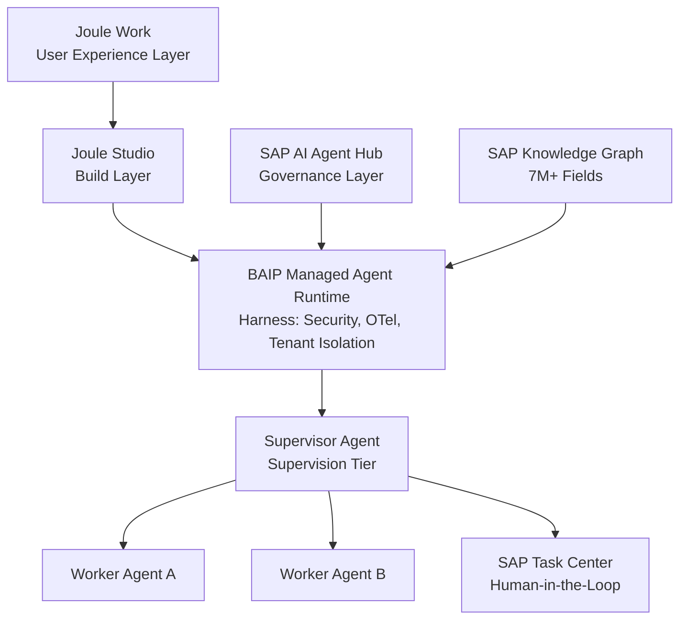

<!-- loioa6daf78c6709444da31df5dc6f692006 -->

# System Architecture and Build Paths

This document describes the AI-Native North Star Architecture, the BAIP platform layers, the Supervisor Agent Pattern, and the three valid build paths for FDE agent delivery. All agent designs in the CIS concept can be implemented on any of the three paths.

<a name="loioa6daf78c6709444da31df5dc6f692006__section_northstar"/>

## AI-Native North Star Architecture \(Four Layers\)

**Architecture Layers**

<table>
<tr>
<th valign="top">

Layer

</th>
<th valign="top">

Name

</th>
<th valign="top">

Components

</th>
</tr>
<tr>
<td valign="top">

1

</td>
<td valign="top">

User Experience

</td>
<td valign="top">

Joule Work — five modes: Conversational, Proactive, Autonomous, Embedded, API-driven

</td>
</tr>
<tr>
<td valign="top">

2

</td>
<td valign="top">

Process

</td>
<td valign="top">

Apps expose capabilities through APIs/events; agents operate in a reason-act-observe loop with self-verification

</td>
</tr>
<tr>
<td valign="top">

3

</td>
<td valign="top">

Foundation \(Cognitive Core\)

</td>
<td valign="top">

SAP Knowledge Graph \(semantic backbone, 7M+ fields\), SAP Business Data Cloud, model services \(SAP-RPT-1 + frontier LLMs via generative AI hub\), context engineering

</td>
</tr>
<tr>
<td valign="top">

4

</td>
<td valign="top">

Platform

</td>
<td valign="top">

BAIP managed agent runtime — auto-enables harness \(security, observability, tenant isolation, persistent memory\); OpenTelemetry-based observability built in

</td>
</tr>
</table>

<a name="loioa6daf78c6709444da31df5dc6f692006__section_build_paths"/>

## Three Build Paths

[Joule Studio](https://help.sap.com/docs/JOULESTUDIO/7e496fe6f81f4975aec07d9c1cbd2aef/36d3e974446844a1b0ffb7af8fa9446c.html) supports two artifact types: **Joule Skill** \(deterministic, repeatable task with predictable execution path\) and **Joule Agent** \(complex, non-deterministic task requiring LLM reasoning and multi-step orchestration\). Most Industry AI FDE use cases require Joule Agents.

**Three Delivery Paths**

<table>
<tr>
<th valign="top">

Path

</th>
<th valign="top">

Entry Point

</th>
<th valign="top">

When to Use

</th>
<th valign="top">

BAIP Harness

</th>
</tr>
<tr>
<td valign="top">

Path 1 — Low/No-Code

</td>
<td valign="top">

Joule Studio visual canvas \(n8n\)

</td>
<td valign="top">

Default for all FDE engagements; covers the majority of Industry AI use cases

</td>
<td valign="top">

Automatic

</td>
</tr>
<tr>
<td valign="top">

Path 2 — Joule Studio CLI \(pro-code\)

</td>
<td valign="top">

`jl` CLI + VS Code + AI coding agent

</td>
<td valign="top">

When low-code canvas is insufficient but Joule Studio governance must be retained

</td>
<td valign="top">

Automatic

</td>
</tr>
<tr>
<td valign="top">

Path 3 — Custom-Managed Joule \(CMJ\) BYOA

</td>
<td valign="top">

A2A Agent Toolkit + BTP CF/Kyma + Customer-Managed Joule CLI

</td>
<td valign="top">

Valid primary delivery path for FDE; mandatory for sovereign/regulated regions \(CN40, NS2, KSA non-reg\)

</td>
<td valign="top">

Team-configured BTP infrastructure

</td>
</tr>
</table>

Joule Studio uses **Intent-Based Development \(IBD\)** as its official methodology: a six-phase workflow — 01 Intent → 02 Requirements → 03 Specification → 04 Solution → 05 Testing → 06 Deployment. See [Create an Agent with the CLI](https://help.sap.com/docs/JOULESTUDIO/7e496fe6f81f4975aec07d9c1cbd2aef/eaf54135911e4915a49b41e7bd3fc512.html) and [Pro-Code Setup](https://help.sap.com/docs/JOULESTUDIO/7e496fe6f81f4975aec07d9c1cbd2aef/7bdd9ed4141a428597a41ce50cdca49e.html) for the pro-code workflow.

> ### Note:  
> All three paths produce agents governed by the same BAIP harness. The build path choice affects development ergonomics, not the production security and governance model. For Path 3, the FDE team is responsible for wiring authentication, observability, and security controls manually.

<a name="loioa6daf78c6709444da31df5dc6f692006__section_supervisor"/>

## Supervisor Agent Pattern

The supervisor agent is the CIS implementation of the Supervision tier for Industry AI FDE engagements. It provides business-logic-level quality and safety for individual agent workflows — within the customer's own environment, without requiring external data movement.

**Supervisor Agent Components**

<table>
<tr>
<th valign="top">

Component

</th>
<th valign="top">

Role

</th>
<th valign="top">

Technology

</th>
</tr>
<tr>
<td valign="top">

Supervisor Workflow A — Inline Quality Relay

</td>
<td valign="top">

Intercepts worker output before write-back; runs deterministic Code node check + LLM critic; routes to commit or Task Center

</td>
<td valign="top">

Joule Studio n8n: `CUSTOM.sapAgent` \(blocking=false\), `CUSTOM.sapOrchestration` critic, `CUSTOM.sapTaskCenter`

</td>
</tr>
<tr>
<td valign="top">

Supervisor Workflow B — Telemetry Monitor

</td>
<td valign="top">

Scheduled job; reads BAIP Cloud Logging and AI Core usage API; evaluates six anomaly rule types; triggers Workflow C on detection

</td>
<td valign="top">

Joule Studio n8n: HTTP Request node, Code node rule logic, cost anomaly checks

</td>
</tr>
<tr>
<td valign="top">

Supervisor Workflow C — Support Relay

</td>
<td valign="top">

Sanitizes trace extracts; creates incident ticket via SAP Incident Management API; notifies IT admin

</td>
<td valign="top">

Joule Studio n8n: sanitization rules, SAP Incident Management API call

</td>
</tr>
</table>

**Supervisor Fail-Safe Rule:** If the supervisor is unavailable, the worker routes all outputs to `sapTaskCenter` — never to autonomous write-back. This is a non-negotiable design constraint.

The supervisor also serves as an **autonomous CIS proxy** on the customer tenant. On a customer-deployed agent running in the customer's own BAIP environment, CIS has no default access for monitoring. The supervisor bridges this gap: it performs the monitoring and intervention that CIS would otherwise need direct access to do, and only escalates to CIS when it has exhausted what it can handle autonomously.

<a name="loioa6daf78c6709444da31df5dc6f692006__section_sap_nodes"/>

## SAP Custom Nodes in Joule Studio

[SAP-Specific Nodes in Joule Studio](https://help.sap.com/docs/JOULESTUDIO/7e496fe6f81f4975aec07d9c1cbd2aef/e2fbd2fd7fda4fceadb7cf2ef4b22530.html) provides the six SAP custom nodes:

-   `CUSTOM.sapAgent` — invokes another registered SAP agent via SAP Agent Gateway \(A2A\)
-   `CUSTOM.sapOrchestration` — primary LLM interface; wraps SAP generative AI hub via [SAP AI Core Orchestration](https://help.sap.com/docs/AI_CORE/d5d03749687449ad9768e46ea9e32b1e/8d022355037643cebf775cd3bf662cc5.html)
-   `CUSTOM.sapMcpClient` — connects to SAP applications via SAP Agent Gateway MCP servers
-   `CUSTOM.sapTaskCenter` — creates human approval tasks in SAP Task Center or Joule Work
-   `CUSTOM.sapContext` — retrieves authorized grounding context from BAIP Knowledge Graph
-   `CUSTOM.sapPromptRegistry` — references versioned, governed prompts from SAP Prompt Registry

**Related Information**  

[Joule Studio Glossary](https://help.sap.com/docs/JOULESTUDIO/7e496fe6f81f4975aec07d9c1cbd2aef/1e214183c85c4e4faff59a96c724f4fb.html)

[SAP AI Core — Models](https://help.sap.com/docs/AI_CORE/d5d03749687449ad9768e46ea9e32b1e/6440777c196642dbb3171aa5c37b987e.html)

[Security and Data Protection](security-and-data-protection-98058b5.md)

[Multi-Agent Orchestration and Production Operations](multi-agent-orchestration-and-production-operations-f4b0467.md)
